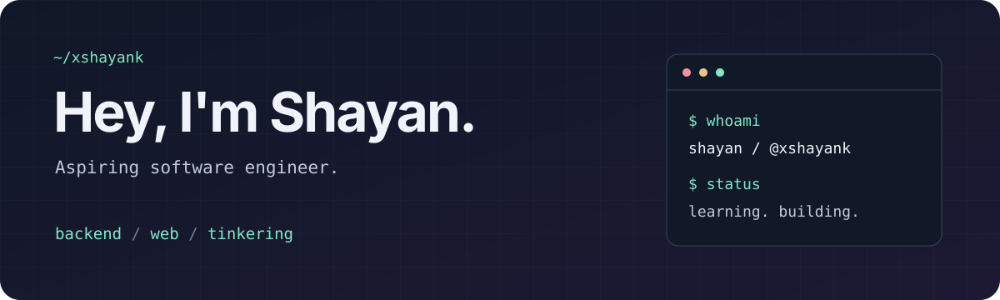

  

  <strong>Student. Backend &amp; web enthusiast. Curious by default.</strong> 
  Based in Shiraz · Online as <a href="https://github.com/xshayank">@xshayank</a>

---

### Hey, I'm Shayan 👋

I'm an aspiring software engineer learning by building. Backend and web development are where I spend most of my coding time: figuring out how things work behind the scenes and turning ideas into something people can use.

I write backend code. It's usually stable. The rest is a learning opportunity.

### Where my interests meet my code

| Focus | What draws me in |
| :--- | :--- |
| **Backend development** | The logic behind the interface — how a request becomes a result. |
| **The web** | Bringing the pieces together into something usable in a browser. |
| **Tinkering** | Making software and my setup work the way I want them to. Hackintosh included. |

### A little beyond the code

- 🎓 A student, still learning and building my own path into software engineering.
- 🖥️ A Hackintosh user — the setup is part of the hobby.
- 🐾 A furry, too. There's a person behind the commits.

### Explore & connect

My repositories are where my work takes shape. Browse what's public, see what I'm building, or follow along as I learn.

[**Browse my repositories →**](https://github.com/xshayank?tab=repositories) &nbsp; · &nbsp; [**Find me on GitHub →**](https://github.com/xshayank)

---

Learning in public, one commit at a time.

